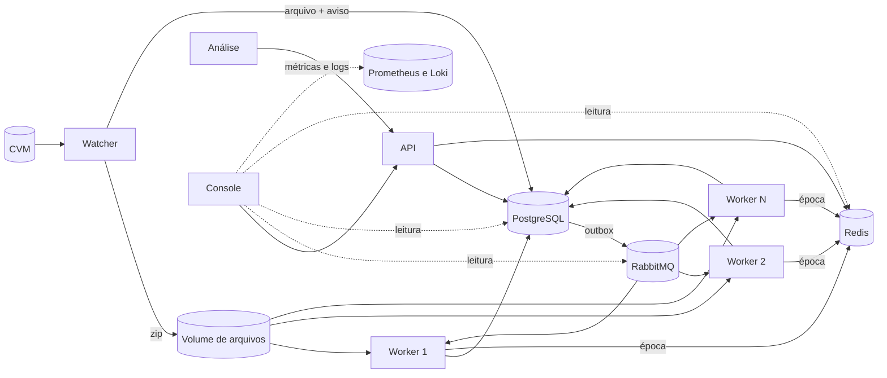

# Nexo

Plataforma que baixa as carteiras dos fundos de investimento publicadas pela CVM, organiza tudo no
PostgreSQL e mostra os dados por uma API e uma interface web. Os dados são mensais e históricos:
não é cotação em tempo real nem recomendação de investimento.

Este é o documento do projeto: a fonte, as decisões em vigor, como o sistema funciona e o que foi medido.
Como rodar está no [README](README.md).

---

## 1. Como trabalhamos

- Teste antes do código; nada é dado como pronto sem rodar a suíte.
- Commits ficam com você.
- Código em inglês; comentários, logs, telas e documentação em português.
- Comentário só para explicar um porquê ou uma esquisitice da fonte, em até duas linhas e linguagem simples.
- Métodos curtos, um tipo por arquivo, nomes que dizem o que a coisa faz, interface só quando há mais de uma implementação ou uma fronteira externa.

---

## 2. A fonte: CVM

| O quê | Onde |
|---|---|
| Carteiras mensais (CDA) | `https://dados.cvm.gov.br/dados/FI/DOC/CDA/DADOS/cda_fi_AAAAMM.zip` (desde 2023-01) |
| Cadastro de fundos e classes | `https://dados.cvm.gov.br/dados/FI/CAD/DADOS/registro_fundo_classe.zip` |
| Dicionários de dados | Pastas `META/` ao lado de cada uma |

Cada zip mensal traz o PL dos fundos, as posições em 8 blocos (títulos públicos, cotas, swap, ações e
debêntures, CDB/LF, crédito privado, exterior, outros), as posições sob sigilo e um arquivo único para
fundos estruturados (FIDC, FIAGRO, FIIM). São cerca de 800 mil linhas por mês.

**O que o código precisa respeitar:**

1. Texto em Latin-1, separado por `;`, com aspas soltas no meio do texto (não são escape).
2. Campo vazio é "não informado", diferente de zero. Valores negativos são legítimos.
3. Meses antigos são republicados por meses (reapresentações e fim de sigilo).
4. Quem envia a carteira é a classe do fundo (regra CVM 175), com CNPJ próprio.
5. Não existe código universal de ativo; cada bloco identifica o ativo de um jeito.
6. Carteira sigilosa não é carteira vazia: só aparece o total por tipo de aplicação.
7. Colunas mudaram de nome em 2023; o leitor aceita os dois nomes.

---

## 3. Decisões em vigor

| Tema | Decisão |
|---|---|
| Arquitetura | API, um watcher e vários workers, conversando por RabbitMQ (orientado a eventos, sem Airflow) |
| Avisos entre processos | Outbox: o aviso é gravado junto com a mudança no banco e enviado depois |
| Confiabilidade | Confirmação do broker, ack manual, 3 novas tentativas com espera crescente, DLQ, idempotência |
| Paralelismo | Vários workers, um arquivo por vez cada; trava por arquivo impede duas versões do mesmo mês juntas |
| Republicação | Revisão nova só para fundos cujo conteúdo mudou (fingerprint); a antiga fica guardada |
| Fundo e classe | Entidades separadas |
| Leitura de CSV | Leitor próprio, em streaming, linha a linha |
| Carga no banco | `COPY` para tabelas temporárias e SQL em conjunto numa transação |
| Posições | Tabela particionada por mês, sem chave estrangeira linha a linha (ver seção 7) |
| Cache | Redis com "época" na chave; só nos endpoints que ganharam tempo medido |
| Telas | Duas apps Streamlit + Plotly: Console (desenvolvedores) e Análise (analistas); só usam contratos existentes; cores validadas para daltonismo |
| Escopo de dados | Todos os meses da pasta `DADOS/` e o cadastro; histórico 2005–2022 fora por enquanto |

---

## 4. Arquitetura

| Projeto | Papel |
|---|---|
| `Nexo.Domain` | Regras puras: CNPJ, identidade de ativo, estados do arquivo |
| `Nexo.Application` | Casos de uso, leitura dos CSVs, contratos de consulta |
| `Nexo.Infrastructure` | PostgreSQL, carga, RabbitMQ, outbox, Redis, cliente da CVM |
| `Nexo.Worker` | Watcher (confere a CVM às 13h e 19h) e processamento |
| `Nexo.Api` | Endpoints REST |
| `frontend/nexo_shared` | Cliente da API, formatação brasileira, rótulos e exportação |
| `frontend/developer_console` | Console: pipeline, filas, workers, recursos, armazenamento e logs |
| `frontend/financial_analytics` | Análise: panorama, fundos, carteira, comparação e ativos |

---

## 5. Banco de dados

| Tabela | Conteúdo |
|---|---|
| `funds`, `fund_classes` | Cadastro (fundo provisório quando a carteira chega antes do cadastro) |
| `assets` | Um registro por ativo, pela chave de identidade de cada bloco |
| `portfolios` | Carteira de um fundo numa data, com revisão e marca de atual |
| `positions` | Linhas da carteira, **uma partição por mês** (`positions_202609`) |
| `dataset_files` | Cada versão baixada de cada arquivo, com status, contagens e erro |
| `rejected_rows` | Linhas rejeitadas, com motivo e texto original |
| `outbox_messages` | Avisos esperando envio ao RabbitMQ |

O desenho segue o modelo estrela: cadastro e ativos são as dimensões (com chave estrangeira), `portfolios`
é o cabeçalho e `positions` é a tabela de fatos, gravada em lote. A integridade de `positions` é garantida
pela carga, que grava carteira, ativo e posição na mesma transação.

---

## 6. Ingestão

1. O watcher lê a listagem da CVM e faz `HEAD` em cada arquivo; se ETag e tamanho mudaram, baixa e calcula o hash.
2. Arquivo e aviso entram no banco na mesma transação; o envio da outbox publica no RabbitMQ.
3. Um worker pega o aviso, assume o arquivo por um prazo (lease) e lê o zip linha a linha.
4. Linhas válidas vão por `COPY` para tabelas temporárias; inválidas vão para `rejected_rows` com motivo.
5. Numa transação: carteiras novas ou alteradas ganham revisão, ativos novos entram, posições vão para a partição do mês.
6. O arquivo fica como processado, a época do cache sobe e a mensagem é confirmada.
7. Erro gera nova tentativa (1, 5 e 25 minutos) e, na quarta falha, DLQ. Desligar o worker libera o arquivo na hora.

---

## 7. Desempenho medido

Carga real de 46 meses e do cadastro, numa máquina de 8 núcleos e 16 GB:

| Configuração | Tempo por mês | Observação |
|---|---:|---|
| Tabela única, PostgreSQL padrão, 1 worker | 158 s → 270 s | Piorava a cada mês: índices com todo o histórico |
| Particionada por mês, com chave estrangeira | ~170 s | Gravar posições pesava ~67% do tempo |
| Particionada, sem chave estrangeira, 1 worker | 38–108 s (média 99) | Estável com 24 milhões de linhas |
| Particionada, sem chave estrangeira, 3 workers | 51–127 s (média 82) | Carga completa (46 meses) em 22 min, sem nenhuma nova tentativa; com 1 worker, 30 meses levaram 50 min |

Experimento isolado (711 mil posições): tabela comum com chave estrangeira 180 s; particionada com chave
estrangeira 132 s; particionada sem chave estrangeira 27 s. A conferência linha a linha travava a mesma
carteira centenas de vezes.

Consultas (4 meses carregados): concentração 4,7 s sem cache e 0,01 s com cache; dashboard 1,5 s e 0,01 s;
carteira do fundo 0,17 s e 0,01 s; demais consultas entre 0,04 e 0,25 s. O worker usa de 108 a 179 MB.

---

## 8. Situação

| Item | Estado |
|---|---|
| Ingestão, API, cache, Console e Análise em Streamlit, Docker Compose, CI | Pronto |
| Testes | 104 de unidade, 47 de integração (Testcontainers), 55 das telas em Python (pytest); todos passam |
| Carga real | 46 meses e cadastro: 38 milhões de posições, 46 partições, 11 GB |

**Achados na fonte:** o cadastro tem 18 linhas repetidas e um CNPJ inválido (`22222222222210`), todos
rejeitados com motivo; o mesmo CNPJ aparece em registros antigos e cancelados, e vale o mais recente.

**Notas do ambiente:** com o Smart App Control do Windows ligado, build e testes do .NET rodam em container
(`scripts/dotnet-container.sh`); as telas em Python também rodam em container, porque a máquina não tem Python.
Usamos FluentAssertions 7 (a última gratuita).

**Limitações conhecidas:**

- Fundos que somem de uma republicação continuam com a carteira da versão anterior.
- Concentração e dashboard levam alguns segundos na primeira chamada após cada ingestão.
- Coluna desconhecida no CSV é ignorada sem aviso; só a falta de coluna obrigatória falha o arquivo.
- Detentores de um ativo sem data levam de 6 a 11 s na primeira chamada (a API procura o último mês em
  todas as partições); com a data, 0,08 s. A Análise pede primeiro o mês mais recente para evitar isso.
- Os contadores de processamento no Prometheus zeram quando o container reinicia; o tempo por arquivo
  que o Console mostra vem do banco e não se perde.

---

## 9. Próximos passos possíveis

- Conferência em conjunto, no fim da carga, de posições sem carteira ou sem ativo.
- Chave estrangeira criada por partição depois da carga, validada numa passada só.
- Bronze em MinIO, prata em Parquet e ouro em ClickHouse para análises de muitos anos.
- Carga do histórico 2005–2022 (~100 milhões de posições).
- Guardar o último mês de cada ativo em `assets` para os detentores responderem rápido sem data.

---

## 10. Glossário

| Termo | Significado |
|---|---|
| CDA | Documento mensal com a carteira de cada fundo |
| PL | Patrimônio líquido do fundo na data |
| Classe | Divisão de um fundo com CNPJ próprio (regra CVM 175) |
| Revisão | Nova versão da carteira de um fundo na mesma data, após republicação |
| Fingerprint | Código que resume o conteúdo de um fundo; se muda, o fundo mudou |
| Outbox | Tabela onde o aviso espera para ser enviado ao RabbitMQ |
| Lease | Prazo em que um worker é dono de um arquivo |
| DLQ | Fila das mensagens que falharam todas as tentativas |
| Época | Número no Redis que muda a cada ingestão e invalida o cache |
| Partição | Pedaço da tabela de posições com um mês só |
