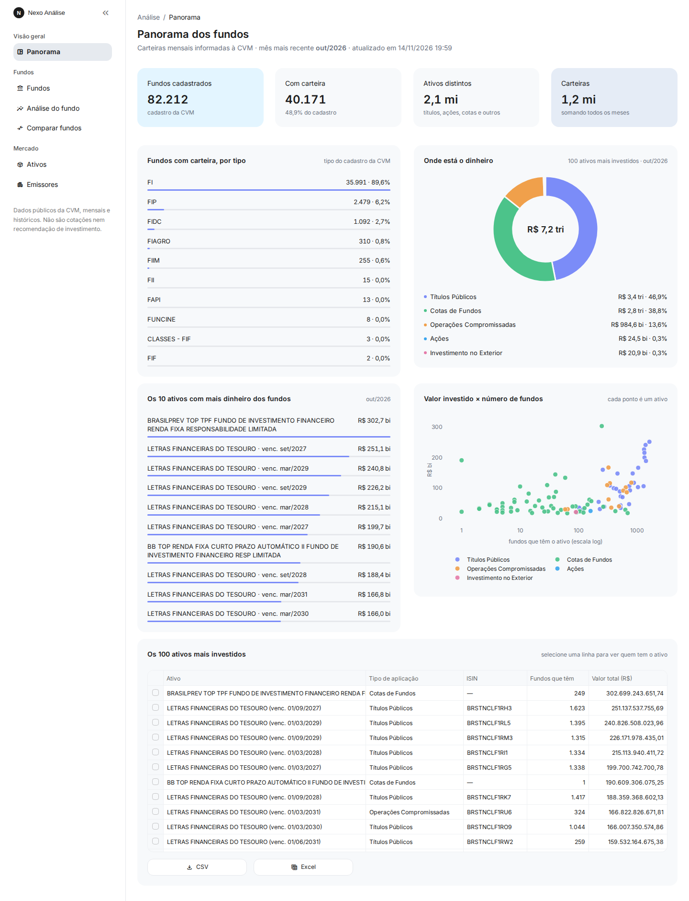
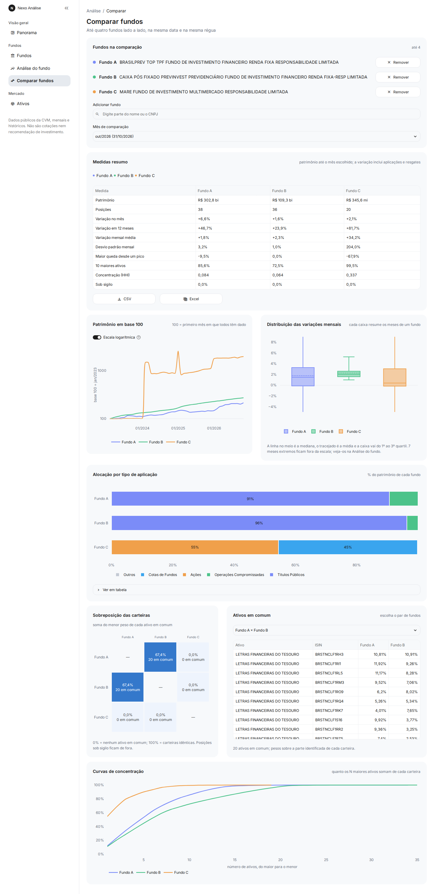
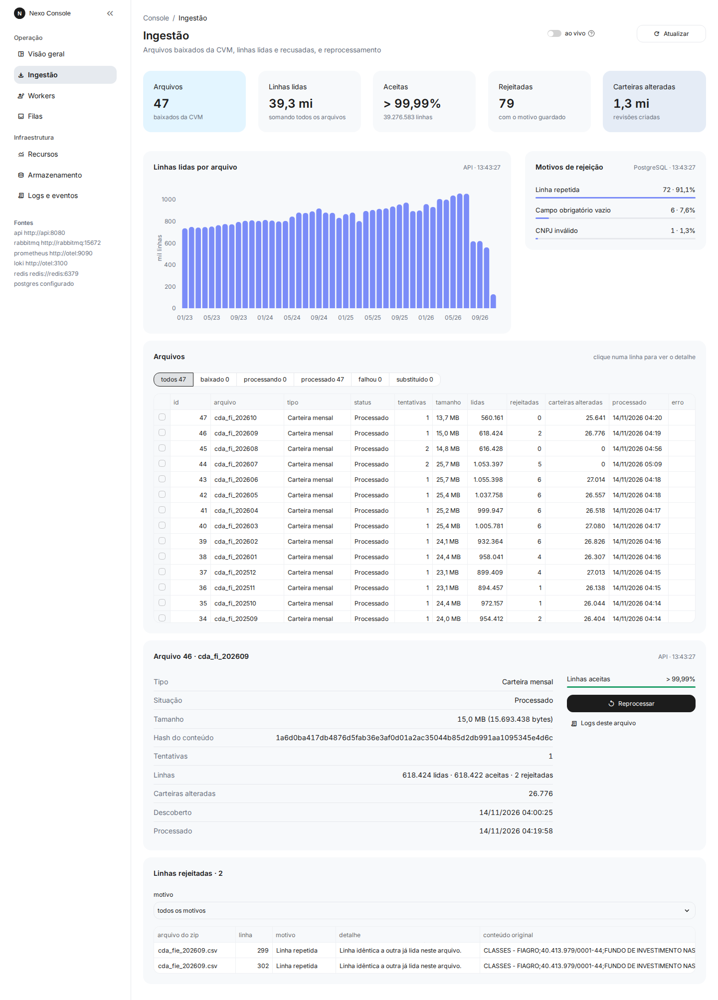
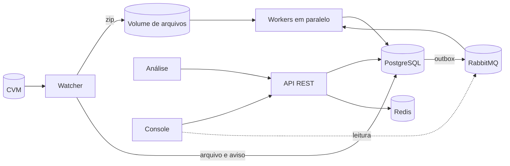

# Nexo

O Nexo transforma os arquivos públicos de carteiras de fundos da CVM em informação fácil de consultar.
Ele baixa os informes mensais, organiza dezenas de milhões de posições num PostgreSQL e entrega tudo por
uma API e por duas telas: a **Análise**, para quem estuda fundos e ativos, e o **Console**, para quem
precisa acompanhar se o pipeline está saudável. Os dados são mensais e históricos; não são cotações em
tempo real nem recomendação de investimento.

O projeto foi pensado como um backend .NET robusto: a ingestão é guiada por mensagens, tolera falhas sem
perder nem duplicar dados e escala colocando mais workers em paralelo. Cada decisão importante foi medida
antes de ser adotada, e o registro completo está em [PLANO.md](PLANO.md).


## Para que serve

A CVM publica todo mês a composição da carteira de cada fundo, mas em arquivos zip com CSVs grandes, em
Latin-1, com colunas que mudam de um bloco para outro e republicações que corrigem meses antigos.
Responder perguntas simples, como "o que este fundo tem?" ou "quais fundos têm este título?", exige
baixar, limpar e cruzar esses arquivos à mão.

O Nexo faz esse trabalho continuamente. Ele confere a CVM duas vezes por dia, baixa só o que mudou,
valida cada linha (guardando o motivo de cada rejeição) e mantém o histórico de revisões quando um mês é
republicado. Um analista pode, por exemplo, abrir um fundo e ver como o patrimônio evoluiu, quão
concentrada é a carteira e quais ativos ele divide com outro fundo, e exportar tudo para o Excel.

## Funcionalidades

- **Ingestão automática da CVM.** Um watcher confere os arquivos ao subir e às 13h e 19h, baixa apenas o
  que mudou (por ETag e hash do conteúdo) e avisa os workers por mensagem.
- **Processamento em paralelo.** Vários workers processam meses diferentes ao mesmo tempo; um prazo de
  posse (lease) e uma trava por arquivo impedem que dois processem o mesmo dado.
- **Entrega confiável de mensagens.** Outbox transacional, confirmação do broker, novas tentativas com
  espera crescente (1, 5 e 25 minutos) e fila de desistências (DLQ).
- **Revisões de carteira.** Quando a CVM republica um mês, só os fundos que realmente mudaram ganham uma
  nova revisão, detectada por uma impressão digital (SHA-256) das linhas de cada fundo.
- **Linhas rejeitadas com motivo.** CNPJ inválido, data de outro mês, linha repetida e outros problemas
  ficam guardados com a linha original, para conferência.
- **API REST de consulta.** Fundos, carteiras, posições, ativos, detentores de um ativo, emissores,
  concentração do mercado, situação da ingestão e reprocessamento de arquivo, com OpenAPI e cache no Redis.
- **Emissores pelo CNPJ.** Cada fundo escreve o nome do emissor de um jeito ("BANCO BMG SA", "BCO BMG SA",
  "BMG"...). A carga guarda, mês a mês, como cada fundo escreveu o nome, e o CNPJ junta todas as formas.
- **Análise (Streamlit).** Panorama do mercado, busca de fundos, análise de um fundo com medidas resumo e
  concentração, comparação de até quatro fundos (inclusive sobreposição das carteiras) e detentores de
  cada ativo, além dos emissores com as formas de escrever o nome e quais fundos usam cada uma; toda tabela
  filtrada exporta para CSV ou Excel.
- **Console (Streamlit).** Saúde dos serviços, arquivos e linhas rejeitadas, workers e tempo de
  processamento, filas do RabbitMQ, CPU e memória, tamanho do banco e busca nos logs; permite pedir o
  reprocessamento de um arquivo.
- **Observabilidade.** Logs estruturados em português (Serilog), traces e métricas via OpenTelemetry,
  visíveis no Grafana e no Console.

## Telas

**Análise · Panorama dos fundos.** Quantos fundos têm carteira, onde está o dinheiro e quais ativos
concentram mais valor, com busca dos fundos que têm cada ativo.



**Análise · Comparar fundos.** Até quatro fundos na mesma data: medidas resumo, patrimônio em base 100,
distribuição das variações mensais, alocação, sobreposição das carteiras e curvas de concentração.



**Console · Ingestão.** Arquivos baixados da CVM, linhas lidas por mês, motivos de rejeição e detalhe de
cada arquivo, com o botão de reprocessar.



## Como funciona

O watcher baixa os zips da CVM para um volume compartilhado e registra cada arquivo no banco junto com um
aviso na tabela de outbox, na mesma transação. O aviso é publicado no RabbitMQ; um worker livre pega a
mensagem, lê o zip em streaming, carrega as linhas em tabelas temporárias com `COPY` e consolida tudo numa
única transação. A API lê o banco e guarda as consultas mais pesadas no Redis; as duas telas consomem a API,
e o Console também lê o RabbitMQ, o Prometheus, o Loki e o PostgreSQL para mostrar a operação.



### Carga rápida e segura

As posições ficam numa tabela particionada por mês de referência e sem chaves estrangeiras linha a linha:
medimos que as chaves estrangeiras custavam cerca de 80% do tempo da carga. A consistência vem do próprio
processo de carga, que resolve fundos e ativos antes de inserir as posições, numa transação protegida por
uma trava por arquivo. Com três workers, os 46 meses disponíveis (cerca de 38 milhões de posições e 11 GB)
carregam em uns 22 minutos, sem nenhuma nova tentativa.

| Camada | Responsabilidade |
|---|---|
| `Nexo.Domain` | Regras puras: CNPJ, identidade de ativos, estados do arquivo |
| `Nexo.Application` | Casos de uso, leitura dos CSVs da CVM, contratos de consulta |
| `Nexo.Infrastructure` | PostgreSQL, carga com `COPY`, RabbitMQ, outbox, Redis, cliente da CVM |
| `Nexo.Worker` | Watcher e processamento das mensagens |
| `Nexo.Api` | Endpoints REST (Minimal APIs) |
| `frontend/` | Telas em Streamlit e o código comum entre elas |

## Tecnologias

| Tecnologia | Uso no projeto |
|---|---|
| .NET 10 e ASP.NET Core Minimal APIs | Watcher, workers e API |
| EF Core 10 e Npgsql | Mapeamento, migração e consultas no PostgreSQL |
| PostgreSQL 17 | Armazenamento, com posições particionadas por mês |
| RabbitMQ 4 (RabbitMQ.Client 7) | Fila de processamento, nova tentativa e DLQ |
| Redis 7 (StackExchange.Redis) | Cache das consultas da API, invalidado a cada ingestão |
| FluentValidation | Validação dos parâmetros da API |
| Serilog e OpenTelemetry | Logs, traces e métricas, enviados ao Grafana (Loki, Tempo e Prometheus) |
| Python 3.13, Streamlit e Plotly | As telas de Análise e Console |
| pandas, httpx e psycopg | Tabelas, chamadas à API e leitura do banco pelo Console |
| xUnit, FluentAssertions, NSubstitute, NetArchTest e Testcontainers | Testes do backend |
| pytest e ruff | Testes e padronização do código Python |
| Docker Compose | Sobe todo o ambiente com um comando |

## Instalação e uso

Pré-requisito: Docker com Docker Compose.

```bash
cp .env.example .env        # troque as senhas antes de usar
docker compose up -d --build
```

Na primeira subida, o watcher baixa o cadastro e todos os meses disponíveis (cerca de 1 GB de zips) e os
workers começam a processar. A página **Ingestão** do Console mostra o andamento.

| Endereço | O que é |
|---|---|
| http://localhost:8502 | Análise: panorama, fundos, análise do fundo, comparação e ativos |
| http://localhost:8501 | Console: ingestão, workers, filas, recursos, armazenamento e logs |
| http://localhost:5080/openapi/v1.json | Contrato da API (OpenAPI) |
| http://localhost:3000 | Grafana com logs, traces e métricas |
| http://localhost:15672 | Painel do RabbitMQ (usuário `nexo`) |

Para desenvolver fora do Docker (requer .NET 10 SDK e Python 3.13), suba só a infraestrutura e rode cada
parte localmente:

```bash
docker compose up -d postgres rabbitmq redis otel migrate
dotnet run --project src/Nexo.Worker
dotnet run --project src/Nexo.Api                      # http://localhost:5080

pip install -r frontend/requirements-dev.txt
cd frontend/financial_analytics && PYTHONPATH=.. streamlit run app.py --server.port 8502
cd frontend/developer_console && PYTHONPATH=.. streamlit run app.py
```

Fora do Docker, o Console lê de variáveis de ambiente a senha do RabbitMQ (`RABBITMQ_PASSWORD`), o banco
(`DATABASE_URL`) e a chave de administrador (`NEXO_ADMIN_API_KEY`). As senhas do `appsettings.json` são
apenas exemplos; para usar a infraestrutura do Compose, passe as do `.env` por variáveis como
`ConnectionStrings__Postgres` e `RabbitMq__Uri`.

## Configuração

Toda a configuração do ambiente fica no `.env`, criado a partir do exemplo. O `.env` nunca vai para o
repositório.

```bash
cp .env.example .env
```

| Chave | Significado |
|---|---|
| `POSTGRES_ADMIN_PASSWORD` | Senha do superusuário do PostgreSQL, usado só na criação do banco |
| `NEXO_DB_PASSWORD` | Senha do usuário da aplicação, dono do banco do Nexo |
| `RABBITMQ_PASSWORD` | Senha do usuário `nexo` no RabbitMQ |
| `NEXO_ADMIN_API_KEY` | Chave exigida pela API para pedir reprocessamento de arquivo |
| `CVM_EARLIEST_MONTH` | Opcional: carrega só a partir de um mês (`AAAA-MM`); vazio carrega tudo |
| `WORKER_REPLICAS` | Quantos workers processam em paralelo (padrão 3; cada um usa cerca de 200 MB) |

## Testes e qualidade

```bash
dotnet test Nexo.slnx                       # unidade e integração do backend
cd frontend && ruff check . && pytest       # telas em Python
```

Os testes de unidade cobrem as regras de domínio, a leitura dos CSVs da CVM e os casos de uso; os de
integração sobem PostgreSQL, RabbitMQ e Redis reais com Testcontainers e usam amostras reais da CVM,
inclusive com dois workers processando ao mesmo tempo. Testes de arquitetura (NetArchTest) garantem que as
camadas não se misturam. No frontend, o pytest cobre o cliente da API, a formatação brasileira, as medidas
de análise dos fundos e a leitura das fontes do Console. Hoje são 104 testes de unidade, 47 de integração e
55 em Python, e o CI do GitHub Actions roda todos a cada push na `main` e em cada pull request.

No Windows com Smart App Control ligado, o sistema bloqueia as DLLs recém-compiladas; nesse caso, rode os
comandos do .NET num container:

```bash
./scripts/dotnet-container.sh 'dotnet test Nexo.slnx'
```

## Estrutura do projeto

```text
Nexo/
  src/
    Nexo.Domain/              # regras puras: CNPJ, identidade de ativos, estados do arquivo
    Nexo.Application/         # casos de uso, leitura dos CSVs, contratos de consulta
    Nexo.Infrastructure/      # PostgreSQL, carga, RabbitMQ, outbox, Redis, cliente da CVM
    Nexo.Worker/              # watcher e processamento das mensagens
    Nexo.Api/                 # endpoints REST
  frontend/
    nexo_shared/              # cliente da API, formatação, rótulos, exportação, cartões e gráficos
    financial_analytics/      # tela de Análise (com DESIGN.md)
    developer_console/        # tela do Console (com DESIGN.md)
    tests/                    # testes pytest
  tests/                      # unidade, integração e amostras reais da CVM
  docs/images/                # capturas das telas usadas neste README
  infrastructure/docker/      # Dockerfiles e script de criação do banco
  scripts/                    # utilitários (testes em container, download de amostras)
  docker-compose.yml          # ambiente completo
  PLANO.md                    # decisões, medições e situação do projeto
  LICENSE                     # licença MIT
```

## Licença

Distribuído sob a licença MIT. Veja o arquivo [LICENSE](LICENSE).

Os dados exibidos vêm do Portal de Dados Abertos da CVM e seguem as condições de uso da própria CVM.
